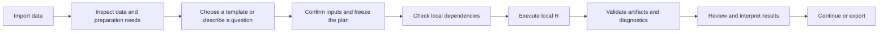
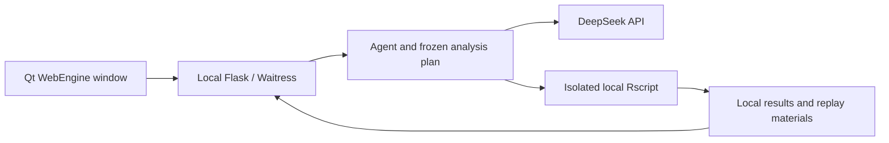

<p align="center">
  
</p>

# Research Statistics Workbench · Data Analysis Agent

**From a research question to local R analysis, figures, and reviewable results.**

[中文](README.md) | **English**

Version **v1.0** · Developer **Z-Joy** · License [Apache-2.0](LICENSE)

Research Statistics Workbench is a local **AI + R tool for scientific and statistical analysis**. Import research data, describe your question in natural language, or start from a built-in template. The application connects data inspection, analysis planning, dependency preparation, local R execution, result review, and export in one workspace.

The catalog contains **213 fixed-script templates across 8 fields**: basic statistics, clinical research, public health, clinical trials and evidence synthesis, behavioral and social sciences, machine learning, time / space / text, and omics / bioinformatics. For custom analyses, the Agent can generate code using the research question, frozen plan, and R packages available on your computer.

The application runs from source in a **PySide6 / Qt WebEngine window**, with **Flask / Waitress serving the local interface** and **your own R installation and packages performing the calculations**. HTML, CSS, and vanilla JavaScript load directly from the repository. Normal startup requires no Node.js, frontend build, APP / DMG / EXE packaging, or activation.

## What can you use it for?

The workbench is intended for researchers, students, and analysts who need to explore research data, fit statistical models, prepare figures, and organize analysis materials. Typical uses include:

- **Routine research statistics:** data quality, descriptive statistics, group comparisons, regression, missing data, and publication tables.
- **Clinical and public health research:** survival analysis, prediction models, complex surveys, propensity scores, causal analysis, and policy evaluation.
- **Specialized analyses:** clinical trials, evidence synthesis, scales and SEM, machine learning, spatial and temporal data, text, and omics.
- **Interactive exploration:** explain your goal, confirm variables and methods, review results, and continue with follow-up questions.
- **Research handoffs:** keep code, plans, environments, diagnostics, and artifacts locally, and export materials for review by yourself or collaborators.

Researchers supply the question, confirm the study design, and interpret the conclusions. The application connects planning, computation, and result organization to make established R methods easier to use.

## Interface preview

### AI analysis assistant


### Analysis catalog


These screenshots show an empty source-run session and the actual catalog. They contain no user research data, API keys, or example analysis conclusions. The displayed R package count reflects the machine used for the screenshots; users prepare their own libraries as needed. The application interface is currently in Chinese; the project introduction is available in Chinese and English.

## Features

| Capability | What it provides |
| --- | --- |
| **Natural-language analysis** | Describe a research goal; the Agent inspects data, establishes a plan, calls R, and interprets results permitted by your sharing settings. |
| **213 fixed templates** | Each template has a stable ID and a registered R implementation with declared inputs, methods, dependencies, and outputs. |
| **Data inspection and preparation** | Inspect fields, types, sample size, missingness, and grouping clues; confirm variables, data roles, and preparation requirements within the supported format and method scope. |
| **Frozen analysis plans** | Bind dataset identity, variables, parameters, methods, and expected artifacts before execution; subsequent execution and continuation check the same `AnalysisPlan`. |
| **Local R and on-demand dependencies** | Reuse installed packages, check missing packages and external tools for the current analysis, and choose a personal or application-specific R library. |
| **Result workspace** | Review tables, figures, models, diagnostics, execution receipts, and explanations, with separate completion, warning, failure, and unassessed states. |
| **Cancellation and continuation** | View progress, cancel operations, save and restore sessions, and continue using checkpoints and frozen plans. Valid artifacts from failed runs remain available. |
| **Export and reproduction materials** | Export Word drafts, Excel workbooks, figures, and delivery bundles with actual R code, environment information, input descriptions, and available replay materials. |
| **Model-sharing controls** | Send filtered summaries by default; generated analysis figures remain off by default. Sensitive columns, individual-level result mode, and attached images have separate controls. |
| **Host environment checks** | Inspect the current machine's OS, Python / Qt, runtime dependencies, R version, installed R package count, and workspace state. |

### Two entry points, one execution pipeline

**Template analysis** suits a specific method request. Select a template, confirm the required inputs against your data, and execute its fixed script within the declared support scope.

**Free analysis** suits custom or combined research tasks. The Agent generates code from the data structure, local R capabilities, and confirmed plan. It uses the same dependency checks, execution, artifact validation, and completion assessment as templates.

AI handles request interpretation, tool orchestration, and explanation of permitted results. Local R computes the numbers, models, and figures. The current source uses a fixed **DeepSeek API** integration with your own API key.

## Analysis coverage

The counts below represent **analysis entry points**. Templates may contain multiple branches; consult the [complete method list](docs/deterministic-templates.md) for the implemented algorithms, input requirements, study designs, and reference-case scope. That detailed list is currently in Chinese.

| Field | Templates | Representative analyses |
| --- | ---: | --- |
| Basic statistics | 24 | Data quality, Table 1, group comparisons, correlation and agreement, linear / generalized linear models, mixed models, bootstrap, GAM, and multiple imputation. |
| Clinical research | 27 | KM / Cox, competing risks, RMST, recurrent events, prediction, ROC, calibration and DCA, propensity scores, target trial emulation, and joint models. |
| Public health | 25 | Epidemiological measures, surveillance, complex surveys, regional multilevel models, DAGs, DID, instrumental variables, environmental exposure, and spatial epidemiology. |
| Clinical trials and evidence synthesis | 29 | Sample size and power, noninferiority / equivalence, group sequential designs, dose finding, primary endpoints, Simon two-stage designs, and pairwise / network / diagnostic meta-analysis. |
| Behavioral and social sciences | 27 | Reliability, EFA, CFA / SEM, Bayesian SEM, IRT, latent classes, measurement invariance, growth models, mediation / moderation, and social networks. |
| Machine learning | 24 | Tabular prediction, trees and boosting, regularization, imbalanced classification, survival learning, feature selection, clustering, explainability, and probability calibration. |
| Time, space, and text | 28 | Time series, interrupted time series, change points, state-space models, GIS, spatial autocorrelation, geostatistics, networks, and text features. |
| Omics and bioinformatics | 29 | Bulk RNA-seq, microarrays, enrichment, WGCNA, single-cell analysis, genomic intervals, microbiome, proteomics, flow cytometry, and multi-omics. |
| **Total** | **213** | **All have registered fixed-script implementations and corresponding reference cases.** |

Reference cases check implementations within their declared scope. They do not cover arbitrary dataset sizes, every algorithm branch, or every study design. Review diagnostics and assess suitability for the specific research data.

## Data import and scientific dataset bundles

Import through clicks, drag and drop, native file selection, or folder selection. One active research dataset may contain a single file or related assets such as an expression matrix, sample annotations, and indexes. Selected files are copied into the local runtime directory; the active dataset is replaced after validation succeeds.

| Input type | Examples and handling |
| --- | --- |
| Tables | CSV / TSV, Excel, SPSS `.sav`, Stata `.dta`, and Parquet. |
| R objects | `.rds`, `.RData` / `.rda`; object type and suitability for the selected method must be established. |
| Expression and single-cell data | Matrix Market / 10x bundles, identifiable 10x HDF5, and H5AD; confirm matrix orientation, expression layer, annotations, and sample / cell / donor relationships. |
| Genomic and other specialized formats | Examples include BED / narrowPeak, GFF / GTF, VCF / BCF, BAM, BIOM, FCS, and mzML / mzXML. Executability depends on the corresponding loader, method, indexes, and local dependencies. |

**Format recognition and method executability are checked separately.** Raw upstream inputs such as FASTQ / FASTA, or generic containers without an established usable object and processing state, are not accepted as analysis-ready merely because their extension is recognized. The project does not provide a complete upstream processing pipeline for all raw sequencing data.

## How an analysis proceeds



1. **Import and inspect.** Review variable types, missingness, data structure, and questions requiring confirmation.
2. **Define your goal.** Select a template or specify the study design, outcome, exposure, covariates, and expected results.
3. **Confirm key inputs.** The assistant asks about ambiguous or missing critical information, then freezes the confirmed plan.
4. **Execute and review.** Prepare dependencies as needed; local R produces results. The workbench checks required artifacts and presents diagnostics, limitations, and failures.
5. **Continue or deliver.** Ask follow-up questions against saved results, or export tables, figures, Word drafts, and reproduction materials.

For example, after importing a cohort dataset with established variable definitions:

> Follow-up time is `followup_time`. The event variable is `event`, with 1 for an event and 0 for censoring. Compare `treatment` groups using KM analysis, then fit a Cox model adjusted for `age` and `sex`. Include a risk table, effect estimates, confidence intervals, and model diagnostics.

The executable plan depends on the actual data, variable coding, and required R packages. Researchers should confirm the necessary information.

## Installation and startup

### Requirements

| Component | Requirement |
| --- | --- |
| Python | Version 3.10 or newer, able to install the pinned dependencies in `requirements.txt`. |
| R | Version 4.3 or newer; `Rscript --version` must work, or specify an absolute Rscript path. |
| Python / Qt dependencies | Install `requirements.txt`, preferably in a virtual environment. |
| AI service | Your own DeepSeek API key, network access, and API credit. API usage is paid by the user. |
| Scientific dependencies | Install R packages and external tools for the methods you need; all method dependencies are not required at startup. |

### macOS / Linux

```bash
git clone https://github.com/SsJjPpHh/data-analysis-agent.git
cd data-analysis-agent
python3 -m venv .venv
source .venv/bin/activate
python -m pip install -r requirements.txt
python -m desktop
```

Linux also requires `bubblewrap` and permission to create the necessary isolated processes. For example, on Debian / Ubuntu:

```bash
sudo apt install bubblewrap
```

### Windows 10 / 11 (PowerShell)

```powershell
git clone https://github.com/SsJjPpHh/data-analysis-agent.git
cd data-analysis-agent
python -m venv .venv
.\.venv\Scripts\python.exe -m pip install -r requirements.txt
.\.venv\Scripts\python.exe -m desktop
```

These commands use the virtual environment's interpreter directly, so changing PowerShell script execution policy is unnecessary. If using Python Launcher, `py -3 -m venv .venv` is also an option.

On first launch, enter your DeepSeek API key in **系统设置 (System Settings)** and check the local R and dependency status. You can then import data and start analysis. The application supplies no shared key and does not inherit configuration from older products.

### Local R, package libraries, and platform configuration

The workbench uses your installed R and existing packages. Missing packages install into the **personal R library** by default; System Settings can select an **application / project-specific library** instead. Prepare compilers, Java, CUDA, CmdStan, and other components as required by your chosen method.

If R is not found, set `BAA_RSCRIPT_BIN` to the absolute path of `Rscript` before launch. Settings and existing results remain accessible when R is temporarily unavailable.

| Platform | R analysis process configuration |
| --- | --- |
| macOS | System `sandbox-exec` limits file and network access. |
| Linux | Uses `bubblewrap`; the system must permit the required isolation processes. |
| Windows 10 / 11 | Uses AppContainer, directory access control, and Job Objects without compiling a helper EXE. Runtime data should reside on local NTFS storage. |

Analysis stops if isolation cannot start. Windows R discovery checks PATH, the registry, and common installation directories. Copy cloud placeholder files and network-share inputs to local storage first. If R temporary-path checks fail, point `BAA_R_TEMP_ROOT` to a local, writable directory you created without spaces in its path. Windows helpers execute tasks sequentially; in-process BLAS / OpenMP threads remain available.

Source implementations are provided for all three platforms. Third-party R packages and external tools must also support your operating system. Native Windows checks and troubleshooting commands are in the [development guide](docs/development.md); these checks were not run on a real Windows machine for this publication.

## Results, exports, and reviewability

The workspace retains actual execution results and their provenance: frozen plans, R code, tables, figures, models, environment and package versions, random-number state, checkpoints, and available replay snapshots. Available materials vary by method and execution step.

| Export | Purpose |
| --- | --- |
| CSV / Excel tables | Inspect calculated values, assemble statistical tables, and continue local processing. |
| Word drafts | Collect saved tables, figures, and result text for further writing. |
| PNG / PDF / TIFF figures | Download actual figures or supported conversions, according to the available artifact formats. |
| Delivery ZIP bundles | Archive analysis results, plans, code, and reproduction materials for review. |
| R replay materials | Attempt to rerun recorded steps after supplying input paths and dependencies. Replay stops when required snapshots are missing. |

Completion, method diagnostics, and scientific review are recorded separately. **Generating the required files does not establish that model assumptions have passed or that a research conclusion has been reviewed.** Read diagnostics and limitations alongside results. Replay materials provide a basis for reproduction; they do not guarantee identical numbers across systems or package versions.

Original uploads are not automatically copied into delivery bundles. Result tables, models, and checkpoints can still contain research data; inspect the contents before sharing.

## Local storage and model sharing

The default runtime directory is **`~/.data-analysis-agent`**. On Windows it is `.data-analysis-agent` under the current user's home directory. Configuration, uploads, sessions, results, logs, and the application-specific package library are stored separately from source code. Set **`BAA_DATA_DIR`** to another absolute path if needed; changing it does not migrate existing data automatically.

Your DeepSeek API key is stored in a private local configuration file. Statistical computation runs locally; model inference uses an external HTTPS API. Your messages, necessary data structure, and permitted results are sent to the model.

| Per-session setting | Default behavior |
| --- | --- |
| Result scope | Send filtered summaries and suppress individual-level results. |
| Sensitive columns | Specify exact column names to filter corresponding result previews seen by the model. |
| Generated analysis figures | Disabled; require separate permission. |
| Images you attach | Enabled by default, with an independent switch. |

Filtering changes the model's view, without deleting local data or altering calculations. Free text you enter and original images you allow are not guaranteed to be anonymous. Content already transmitted cannot be withdrawn through local settings. See [model-sharing controls](docs/model-sharing-controls.md) and [local operation and security boundaries](SECURITY.md).

## Architecture and source layout



Six tools handle the main Agent workflow: inspect data, set an analysis plan, execute R, query installed packages, query package help, and ask the user. Templates and free analysis share dataset contracts, workflows, result validation, and session state.

```text
data-analysis-agent/
├── desktop/          # Source-run window, file selection, startup, shutdown
├── api/              # Local API, sessions, jobs, results, exports
├── agent/            # Agent, catalog, plans, workflows, method implementations
├── r_runtime/        # Local R, dependencies, resources, isolation, replay
├── data/             # Dataset, workspace, session, plan, result storage
├── infrastructure/   # Paths, HTTP, logs, dependency checks, file utilities
├── LLM/              # Local DeepSeek configuration
├── templates/        # Workbench HTML
├── static/           # CSS and JavaScript
├── tests/            # Core, UI, runtime, scientific method checks
├── scripts/          # Catalog, scientific dependency, publication checks
└── docs/             # Architecture, methods, data contracts, development
```

For frontend or API development, `python app.py` starts the loopback service. Normal use is through `python -m desktop`. The project is designed for one machine and one user, and does not provide a public multi-user service.

## Documentation and development

The detailed guides below are currently in Chinese. This English README covers the product, features, installation, usage, configuration, and operational boundaries.

| Document | Contents |
| --- | --- |
| [中文 README](README.md) | Complete Chinese project introduction. |
| [Architecture](docs/architecture.md) | Window, service, Agent, R, contracts, artifacts, and shutdown. |
| [Analysis inputs and preparation](docs/analysis-catalog-v4.md) | Formats, input contracts, preparation, and frozen plans; v4 refers to the contract schema. |
| [Complete method list](docs/deterministic-templates.md) | All 213 templates, implementation scope, and reference cases. |
| [Model-sharing controls](docs/model-sharing-controls.md) | Summary results, sensitive columns, images, history, and restoration. |
| [Development and validation](docs/development.md) | Development dependencies, local checks, R reference tests, and Windows troubleshooting. |
| [Test layout](tests/README.md) | Regression and scientific test groups and commands. |
| [Security boundaries](SECURITY.md) | Local API, credentials, R isolation, model requests, and exported data. |

Development tools are unnecessary for ordinary use. To contribute, install `requirements-dev.txt` and run relevant checks using the [development guide](docs/development.md). The repository has no GitHub Actions configuration; validation tools run locally as needed.

Use [Issues](https://github.com/SsJjPpHh/data-analysis-agent/issues) to report problems and suggest improvements, and Pull Requests to contribute code or documentation. Include your OS, Python / R versions, reproduction steps, and error messages with credentials removed. Use a minimal synthetic dataset when data is needed to reproduce a problem.

## License and developer

Project source is licensed under the [Apache License 2.0](LICENSE). Python, Qt, R, and third-party packages retain their respective licenses.

**Developer: Z-Joy**
