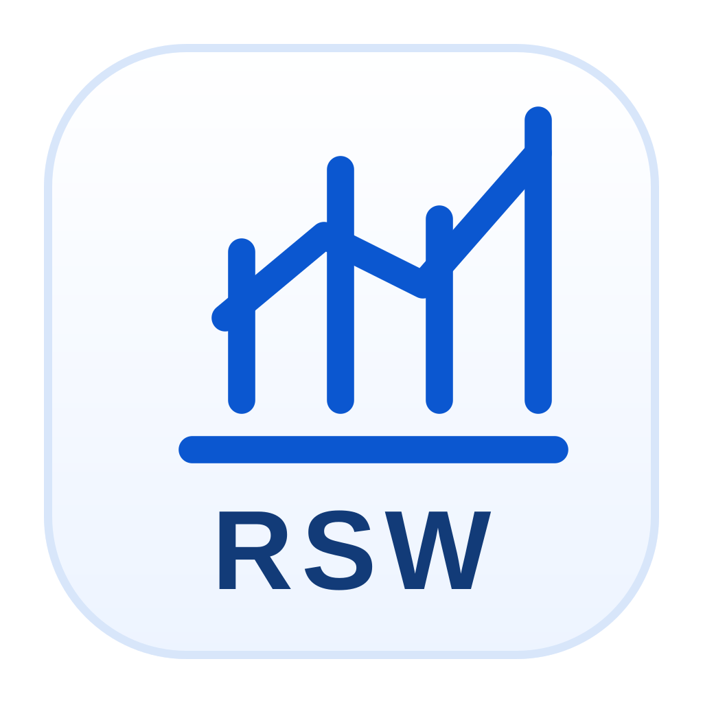
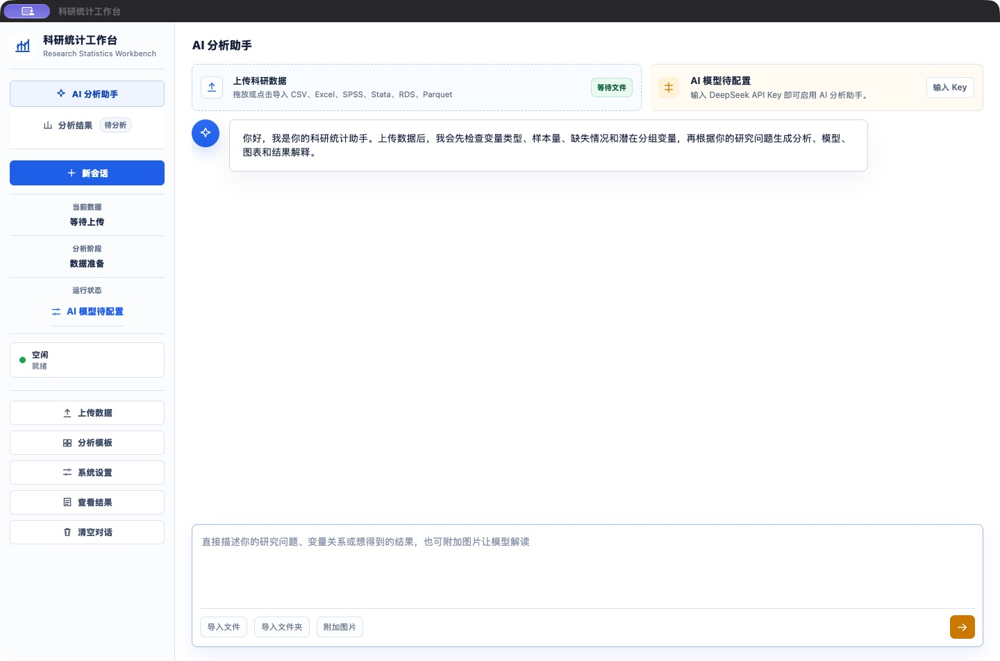
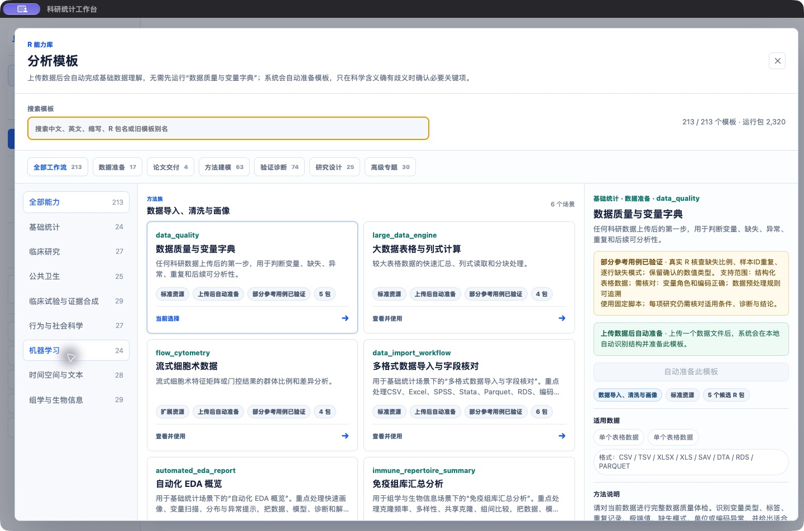
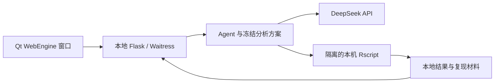

<p align="center">
  
</p>

# 科研统计工作台 · Data Analysis Agent

**从研究问题到本机 R 分析、图表与可复核的研究结果。**

**中文** | [English](README.en.md)

版本 **v1.0** · 开发者 **Z-Joy** · 许可证 [Apache-2.0](LICENSE)

科研统计工作台是一个本机运行的 **AI + R 科研统计分析工具**。你可以上传研究数据，用自然语言描述问题，或从内置分析模板开始；应用负责连接数据检查、分析方案、依赖准备、本机 R 计算、结果查看和导出，把这些步骤放在同一个工作界面中。

项目提供 **8 个领域、213 个固定脚本模板**，覆盖基础统计、临床研究、公共卫生、临床试验与证据合成、行为与社会科学、机器学习、时间空间与文本、组学与生物信息。需要定制分析时，Agent 也可以根据研究问题、冻结方案和本机 R 包生成代码。

应用以源码运行，通过 **PySide6 / Qt WebEngine 打开独立窗口**，使用 **Flask / Waitress 提供本地服务**，调用 **用户自己的 R 和 R 包**完成计算。前端是 HTML、CSS 和原生 JavaScript，直接随源码加载；日常启动无需 Node.js、前端构建、APP / DMG / EXE 打包或激活。

## 项目适合做什么

它面向需要处理研究数据、开展统计建模、制作图表并整理分析材料的研究者、学生和分析人员，尤其适合：

- **常规科研统计：** 数据质量检查、描述统计、组间比较、回归、缺失数据处理和论文表格。
- **临床与公共卫生研究：** 生存分析、预测模型、复杂抽样、倾向评分、因果分析及政策评估。
- **专题分析：** 临床试验、证据合成、量表与 SEM、机器学习、时空数据、文本及组学分析。
- **交互式探索：** 描述分析需求、确认变量与方法、查看结果后继续提问和补充分析。
- **研究材料整理：** 在本机保留代码、方案、环境、诊断和产物，导出给自己或合作者复核。

研究者负责提出问题、确认研究设计并解释结论。应用把规划、计算与结果组织连接起来，让使用已有 R 方法更方便。

## 界面预览

### AI 分析助手



### 分析模板目录



截图来自源码运行的空白会话和模板目录，不含用户研究数据、API Key 或示例分析结论。图中的 R 包数量来自截图机器的本机环境，使用者按需准备自己的包库。当前应用界面为中文；项目首页提供中英文说明。

## 主要功能与特性

| 能力 | 具体内容 |
| --- | --- |
| **自然语言分析** | 用研究问题描述目标，Agent 检查数据、建立方案、调用 R，并结合允许发送的结果解释分析。 |
| **213 个固定模板** | 各模板按稳定 ID 接入固定 R 实现，声明输入、方法、依赖和输出；详情可查看对应方法清单。 |
| **数据理解与准备** | 检查字段、类型、样本量、缺失和分组线索；在当前格式和方法支持范围内，确认变量、数据角色及必要准备步骤。 |
| **冻结分析方案** | 执行前绑定数据身份、变量、参数、方法与预期产物；后续执行和续写核对同一份 `AnalysisPlan`。 |
| **本机 R 与按需依赖** | 使用已有 R 包库，按本次分析检查缺失包和外部工具；支持个人包库与应用专属包库。 |
| **结果工作台** | 集中查看表格、图形、模型、方法诊断、执行回执和结果解释，区分完成、警告、失败与未评估。 |
| **取消与继续分析** | 显示执行进度，支持取消、会话保存与恢复；通过 checkpoint 和冻结方案衔接后续分析，失败保留已有有效产物。 |
| **导出与复现材料** | 导出 Word 草稿、Excel 表格包、图形和交付包，保留实际 R 代码、环境、输入说明及可用的回放材料。 |
| **模型外发设置** | 默认仅发送筛选后的汇总结果，自动分析图默认不发送；敏感列、个体结果模式和主动图片附件分别控制。 |
| **本机环境检查** | 显示当前机器的操作系统、Python / Qt、实际运行依赖、R 版本、R 包数量和工作区状态。 |

### 两种分析入口，一条执行链

**模板分析**适合明确的方法需求。选择模板后，应用结合数据确认关键输入，在该模板声明的支持范围内执行固定脚本。

**自由分析**适合需要定制或组合方法的研究问题。Agent 基于数据结构、本机 R 能力和确认后的方案生成代码，并经过相同的依赖检查、执行、产物校验与完成判定。

AI 负责理解需求、组织工具调用和解释允许发送的结果；实际数值、模型和图形由本机 R 计算。当前源码固定接入 **DeepSeek API**，用户配置自己的 API Key。

## 分析能力覆盖

下表统计的是**分析入口数**。每个模板可以包含不同分支，具体算法、输入、研究设计和参考用例范围以[完整方法清单](docs/deterministic-templates.md)为准。

| 领域 | 模板数 | 代表性分析 |
| --- | ---: | --- |
| 基础统计 | 24 | 数据质量、Table 1、组间比较、相关与一致性、线性 / 广义线性模型、混合模型、Bootstrap、GAM、多重插补。 |
| 临床研究 | 27 | KM / Cox、竞争风险、RMST、复发事件、预测模型、ROC、校准与 DCA、倾向评分、目标试验模拟、联合模型。 |
| 公共卫生 | 25 | 流行病学指标、监测趋势、复杂抽样、区域多层模型、DAG、DID、工具变量、环境暴露、空间流行病学。 |
| 临床试验与证据合成 | 29 | 样本量与把握度、非劣效 / 等效、群序贯、剂量探索、主终点、Simon 二阶段、成对 / 网络 / 诊断 Meta 分析。 |
| 行为与社会科学 | 27 | 信度、EFA、CFA / SEM、贝叶斯 SEM、IRT、潜类别、测量等值性、增长模型、中介 / 调节、社会网络。 |
| 机器学习 | 24 | 表格预测、树模型与 Boosting、正则化、不平衡分类、生存学习、特征筛选、聚类、可解释性和概率校准。 |
| 时间空间与文本 | 28 | 时间序列、中断时间序列、变化点、状态空间、GIS、空间自相关、地统计、网络图和文本特征。 |
| 组学与生物信息 | 29 | Bulk RNA-seq、芯片、富集分析、WGCNA、单细胞、基因组区间、微生物组、蛋白组、流式和多组学。 |
| **合计** | **213** | **均已登记固定脚本实现和对应参考用例。** |

参考用例用于检查声明范围内的方法实现。它们不覆盖任意数据规模、全部算法分支或所有研究设计；具体数据上的诊断与研究判断仍需结合结果查看。

## 数据导入与科学数据包

支持点击、拖拽、原生文件选择和文件夹导入。一个活动研究数据集可以由单个文件组成，也可以包含表达矩阵、样本注释、索引等相互关联的资产。导入文件会复制到本地运行目录，检查通过后再替换当前数据集。

| 输入类型 | 示例与处理方式 |
| --- | --- |
| 常规表格 | CSV / TSV、Excel、SPSS `.sav`、Stata `.dta`、Parquet。 |
| R 对象 | `.rds`、`.RData` / `.rda`；需识别对象类型，并确认其满足所选方法的输入要求。 |
| 表达与单细胞数据 | Matrix Market / 10x 数据包、可识别的 10x HDF5、H5AD；需确认矩阵方向、表达层、样本 / 细胞注释与供体关系。 |
| 基因组与其他专题格式 | 例如 BED / narrowPeak、GFF / GTF、VCF / BCF、BAM、BIOM、FCS、mzML / mzXML；按对应 loader、方法、索引及本机依赖判断可执行性。 |

**格式可识别与方法可执行分别检查。** FASTQ / FASTA 等上游原始数据，以及缺少可用对象或处理信息的通用容器，不会仅凭扩展名被当作可直接分析的输入。项目不提供覆盖所有测序原始数据的上游预处理流水线。

## 一次分析如何完成


1. **导入并理解数据。** 查看变量类型、缺失、数据结构和需要确认的问题。
2. **提出分析目标。** 选择模板，或说明研究设计、结局、暴露、协变量和预期结果。
3. **确认关键输入。** 有歧义或缺少关键参数时，助手会请求补充；确认后冻结分析方案。
4. **执行与查看结果。** 按需准备依赖，本机 R 生成结果；工作台核对所需产物并展示诊断、限制和失败信息。
5. **继续或交付。** 基于已保存结果继续提问，或导出表格、图形、Word 草稿和复现材料。

例如，上传一份变量定义明确的队列数据后，可以提出：

> 随访时间是 `followup_time`，事件变量是 `event`，1 表示发生事件、0 表示删失。请按 `treatment` 分组进行 KM 分析，再用 Cox 模型调整 `age` 和 `sex`，输出风险表、效应估计、置信区间和模型诊断。

实际可执行方案取决于数据、变量编码和所需 R 包。必要信息应由研究者确认。

## 安装与启动

### 运行要求

| 组件 | 要求 |
| --- | --- |
| Python | 3.10 或更高版本，能够安装 `requirements.txt` 中的固定依赖。 |
| R | 4.3 或更高版本，`Rscript --version` 可用，或显式指定 Rscript 路径。 |
| Python / Qt 依赖 | 按 `requirements.txt` 安装，建议使用虚拟环境。 |
| AI 服务 | 自己的 DeepSeek API Key、网络和 API 额度；模型调用费用由用户承担。 |
| 科学依赖 | 按实际方法准备 R 包及必要外部工具，启动时无需安装全部方法依赖。 |

### macOS / Linux

```bash
git clone https://github.com/SsJjPpHh/data-analysis-agent.git
cd data-analysis-agent
python3 -m venv .venv
source .venv/bin/activate
python -m pip install -r requirements.txt
python -m desktop
```

Linux 另需安装 `bubblewrap`，并允许系统创建相应隔离进程。例如 Debian / Ubuntu：

```bash
sudo apt install bubblewrap
```

### Windows 10 / 11（PowerShell）

```powershell
git clone https://github.com/SsJjPpHh/data-analysis-agent.git
cd data-analysis-agent
python -m venv .venv
.\.venv\Scripts\python.exe -m pip install -r requirements.txt
.\.venv\Scripts\python.exe -m desktop
```

这些命令直接使用虚拟环境中的 Python，无需修改 PowerShell 的脚本执行策略。若使用 Python Launcher，也可用 `py -3 -m venv .venv` 创建环境。

首次进入应用后，在**系统设置**中填写自己的 DeepSeek API Key，检查本机 R 和依赖状态，即可导入数据开始分析。应用不提供共享密钥，不自动继承旧产品的配置。

### 本机 R、包库与平台配置

默认使用用户已安装的 R 和包库。缺失包默认安装到 **R 个人包库**；也可以在系统设置中选择 **应用 / 项目专属库**。编译器、Java、CUDA、CmdStan 等组件按所选方法准备。

找不到 R 时，在启动前将 `BAA_RSCRIPT_BIN` 设为 `Rscript` 的绝对路径。R 暂不可用时，应用仍可以打开设置和查看已有结果。

| 平台 | R 分析进程的执行配置 |
| --- | --- |
| macOS | 使用系统 `sandbox-exec` 限定文件和网络访问。 |
| Linux | 使用 `bubblewrap`；系统须允许所需的隔离进程。 |
| Windows 10 / 11 | 使用 AppContainer、目录访问控制和 Job Object，无需编译辅助 EXE；运行数据应位于本地 NTFS 目录。 |

隔离启动失败时停止分析。Windows 的 R 发现支持 PATH、注册表和常见安装目录；云盘占位文件及网络共享数据应先复制到本地。若 R 临时路径兼容性检查未通过，可将 `BAA_R_TEMP_ROOT` 指向自己创建的无空格、可写、本地临时目录。Windows helper 顺序执行任务，BLAS / OpenMP 的进程内线程仍可使用。

源码提供上述三个平台的运行实现，第三方 R 包及外部工具仍须支持用户的系统。Windows 原生验收用例与排查命令见[开发文档](docs/development.md)；本次发布未在真实 Windows 机器上执行这些用例。

Windows 首次安装后可按[最小验收方案](docs/windows-acceptance.md)运行
`scripts/windows_selfcheck.py`，检查环境、本机 R、中文路径及原生隔离，并保存通过、失败和跳过记录。
提供脚本不代表已完成 Windows 原生验收。

## 结果、导出与可复核性

工作台保存的是实际执行结果及其来源，包括冻结计划、R 代码、表格、图形、模型、环境与包版本、随机数状态、checkpoint 和可用的回放快照。不同方法和执行步骤提供的材料会有所不同。

| 导出内容 | 用途 |
| --- | --- |
| CSV / Excel 表格 | 查看计算值，整理统计表格，继续进行本机处理。 |
| Word 草稿 | 汇集已保存表格、图形和结果文字，作为进一步写作的材料。 |
| PNG / PDF / TIFF 图形 | 下载实际图形或对应的格式转换结果；以产物可用格式为准。 |
| 交付 ZIP 包 | 汇集分析结果、计划、代码和复现材料，便于存档与复核。 |
| R 回放材料 | 在自行提供输入路径和所需依赖后，尝试重跑已记录的执行步骤；缺少必要快照时明确停止。 |

完成状态、方法诊断和科学复核状态分别记录：**所需文件已生成，不等于模型假设已经通过，也不等于研究结论已经获得复核。** 结果应同时查看诊断与限制。回放材料提供复现基础，不保证不同系统和包版本下数值完全相同。

原始上传文件不会自动复制进交付包；结果表、模型和 checkpoint 仍可能包含研究数据，分享时应检查实际内容。

## 数据存放与模型外发

默认运行目录为 **`~/.data-analysis-agent`**，Windows 对应当前用户主目录下的 `.data-analysis-agent`。配置、上传文件、会话、结果、日志及应用专属包库保存在这里，和源码目录分离。可通过 **`BAA_DATA_DIR`** 指定其他绝对路径；更改路径不会自动迁移旧数据。

DeepSeek API Key 保存在本机私有配置文件中。统计计算在本机完成；模型推理通过 HTTPS 使用外部 API，用户输入、必要数据结构及允许发送的结果会发给模型。

| 当前会话设置 | 默认行为 |
| --- | --- |
| 结果发送范围 | 仅发送筛选后的汇总结果，屏蔽个体结果。 |
| 敏感列 | 用户可以按精确列名指定，过滤模型所见的结果预览。 |
| 自动分析图 | 不发送，需要单独允许。 |
| 主动附加的图片 | 默认允许，由独立开关控制。 |

过滤只改变模型视图，不删除本机数据、不改变计算结果。手工输入的自由文本和允许发送的原图不保证匿名；已经发送的内容不能通过本机设置撤回。详见[模型外发控制](docs/model-sharing-controls.md)与[本地运行和安全边界](SECURITY.md)。

## 技术架构与源码结构



Agent 使用六个工具完成主要编排：数据检查、设置分析方案、执行 R、查询本机包、查询包帮助和询问用户。模板与自由分析共用现有数据合同、workflow、结果校验和会话状态。

```text
data-analysis-agent/
├── desktop/          # 源码窗口、文件选择、启动与退出
├── api/              # 本地接口、会话、任务、结果与导出
├── agent/            # Agent、分析目录、方案、workflow 与方法实现
├── r_runtime/        # 本机 R、依赖、资源、隔离与回放
├── data/             # 数据集、工作区、会话、计划与结果存储
├── infrastructure/   # 路径、HTTP、日志、运行依赖与文件工具
├── LLM/              # DeepSeek 本机配置
├── templates/        # 工作台 HTML
├── static/           # CSS 与 JavaScript
├── tests/            # 核心、界面、运行环境与科学方法检查
├── scripts/          # 目录审计、科学依赖与发布检查
└── docs/             # 架构、方法、数据合同与开发说明
```

开发前端或 API 时，也可以使用 `python app.py` 启动本机回环服务。正常使用推荐 `python -m desktop`；项目按单机、单用户设计，不提供公网多人服务。

## 文档与开发

| 文档 | 内容 |
| --- | --- |
| [English README](README.en.md) | 完整英文项目介绍和安装说明。 |
| [架构与运行链](docs/architecture.md) | 窗口、服务、Agent、R、合同、产物和退出流程。 |
| [分析输入与准备](docs/analysis-catalog-v4.md) | 数据格式、输入合同、准备机制与冻结方案；v4 表示合同版本。 |
| [完整方法清单](docs/deterministic-templates.md) | 213 个模板及各自的实现、支持范围和参考用例。 |
| [模型外发控制](docs/model-sharing-controls.md) | 汇总、敏感列、图片、历史上下文与恢复的规则。 |
| [开发与验证](docs/development.md) | 开发依赖、本机检查、R 参考测试和 Windows 排查命令。 |
| [测试目录说明](tests/README.md) | 当前回归与科学测试的分组和运行方式。 |
| [安全边界](SECURITY.md) | 本地接口、密钥、R 隔离、模型发送和导出数据的边界。 |

普通使用无需安装开发工具。参与开发时，再安装 `requirements-dev.txt`，按照[开发文档](docs/development.md)运行相关检查。项目不包含 GitHub Actions 配置，验证工具在本机按需运行。

欢迎通过 [Issues](https://github.com/SsJjPpHh/data-analysis-agent/issues) 报告问题或提出改进，通过 Pull Request 贡献代码和文档。问题报告请提供操作系统、Python / R 版本、复现步骤和去除密钥的错误信息；涉及数据时使用最小合成样例。

## 许可证与开发者

项目源码采用 [Apache License 2.0](LICENSE)。Python、Qt、R 和各第三方包遵循各自许可证。

**开发者：Z-Joy**

