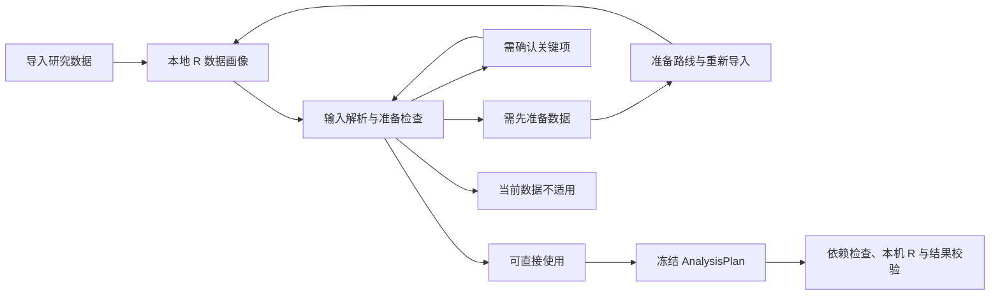

# 分析输入与准备机制

分析目录保留 8 个分类、213 个用户模板及稳定模板 ID。模板执行注册固定脚本，自由分析由 AI 按冻结方案生成代码；两者共用输入准备、依赖预检、本机 R 执行与结果合同。实现与参考测试范围见 [方法清单](deterministic-templates.md)。

## 类型化输入

每个输入有稳定的科学语义 ID，而不是位置或哈希名称。输入合同声明：

- `kind`：数据集、单列、多列、水平、参数、对象或 specification；
- `requirement`：关键、条件必需或可选；
- `accepts`：允许的语义类型；
- `auto_select` 与 `confirmation`：可自动解析的范围及确认要求；
- `default`、`choices`、`required_when`、`min_items`：默认值、方法分支、条件和集合要求。

参数、研究设计和模型语法使用相应控件，不作为列下拉框。关键输入数量由方法需要决定，不人为限定最多几项。不同的标量科学角色不能静默绑定同一列。

`input_contract.at_least_one` 表达替代输入要求；方法分支按当前输入选择依赖包和输出条件。缺失正确实现包交给依赖检查处理，不用无关已安装包替代。

## 准备流程

画像包含字段位置、稳定列 ID、R 类型、语义类型、缺失、唯一值、对象表示、模态、assay 和轴信息。完整低基数水平和角色记忆保存在本地；关键水平需要确认时，界面才提供相应候选。

数据集及完整对象绑定当前数据；多列按类型解析；单列只在语义明确时自动选择。标准参数采用合同默认值。存在歧义、关键研究信息缺失或必要数据表示不足时，应用等待用户确认或准备数据。

缺少索引、样本注释、特征轴、参考资产或上游处理时，返回明确准备路线。能够安全完成的处理可以调用本机 R；外部程序和实验信息由用户补齐。处理层保留原始数据，新数据检查通过后恢复分析目标，但不绕过用户确认自动执行。

## 科学对象与矩阵

扩展名可识别、格式可加载和模板可执行是不同事实。科学资产注册表区分可加载格式、侧车资产和需要上游准备的格式；下游继续检查主资产、对象结构、处理阶段与科学模态。

普通 CSV / Excel 不会仅因含多列数值而成为科学矩阵。表格适配需要确认观测为行、特征为列，并绑定数值特征、观测 ID 和匹配注释。单细胞/空间数据须区分细胞或 spot ID 与供体/样本 ID。原生对象使用实际 assay 与轴证据；不支持表格适配的方法继续要求完整对象或科学数据包。

## 冻结与执行

准备成功后服务端保存冻结 `AnalysisPlan`。前端提交 `plan_id`，服务端核对会话、数据集 ID、工作区代际与画像版本，从本地存储恢复计划；前端临时传入的模板字段不是执行事实来源。

已确认的语义角色可以复用，但缓存键包含数据身份、工作区代际和画像版本。替换数据或画像变化使旧角色失效。用户改变一个角色后，准备器重新平衡相关列集合，避免同一变量重复进入不兼容角色。

固定脚本和自由代码都必须实际使用冻结的列、水平、参数、对象与 specification；静态检查和运行时访问断言共同拒绝未使用或伪造的绑定。计划冻结后，续写不能静默替换输入。

同一具体 R 失败只允许一次明确自动修正，连续多个不同失败会停止；依赖等待、数据准备和策略阻断立即暂停。完成的多阶段分析可以继续，不把正常步骤当作失败重试。

## 输出与解释

模板的方法级输出合同是基线。方法族不会自动加入无关结果，例如聚类不因属于机器学习就强制生成预测校准图。新增结果须同时匹配数据条件和用户意图。

`required=true` 的结果必须完成；不适用的结果保留科学原因。实际执行成功、必需产物完整、方法诊断和科学复核分别记录。固定脚本登记与参考用例通过不能证明所有研究设计和任意输入正确。

本机资源策略按数据规模、CPU、内存和资源类别决定工作进程及线程预算；并行仅用于独立且足够重的任务。模型解释视图另外受 [外发设置](model-sharing-controls.md) 约束，不改变冻结计划和完整本机结果。
