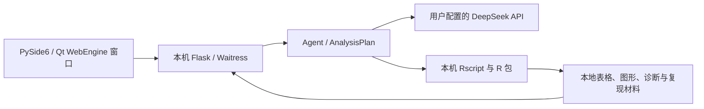

# 架构与运行链

项目是源码运行的单用户工作台。独立窗口、前端页面与后端共用一套分析实现。

## 启动与退出

`python -m desktop` 获取当前运行目录的单实例锁，发现本机 R，并启动随机回环端口。窗口以一次性令牌建立本地会话，再加载工作台页面。R 暂不可用时保留设置与已有结果查看能力。关闭窗口会停止本地服务并取消已登记的分析和安装进程。

`desktop/` 仅负责窗口、文件选择、启动与退出；分析逻辑位于 `agent/`、`api/` 和 `r_runtime/`。前端为 HTML、CSS 和原生 JavaScript，由后端直接提供，不需要独立前端构建。

## 资源与数据

模板、静态文件、分析目录和 R helper 直接读取项目源码文件。运行目录默认是 `~/.data-analysis-agent`，可通过 `BAA_DATA_DIR` 指定绝对路径；配置、数据、会话、结果和日志写入这里。运行目录与代码更新分离，不自动继承旧产品数据或模型密钥。

导入一个研究数据集时，可以选择单文件或完整文件夹。应用复制所选资产并保留科学数据包关系，验证成功后才替换活动数据集。服务端只使用确切路径的一次性导入授权，模型和前端不接收宿主机源路径。

`desktop_assets/icons/rsw-app-icon.png` 是窗口使用的图标，旁边的 SVG 是可编辑源；两者均为源码资源。

## 核心合同

| 合同 | 当前职责 |
| --- | --- |
| Scientific Dataset Bundle | 一个活动研究数据集及其资产关系，保留格式、角色、不可变导入元数据和结构画像。 |
| Analysis Template | 稳定的分析入口，声明意图、输入和基线输出。自由分析以自然语言表达研究需求。 |
| AnalysisPlan | 冻结本次数据身份、变量、参数、方法与预期输出；执行及续写都核对同一方案。 |
| Scientific Output Portfolio | 本次方案适用的核心、推荐、条件、诊断和敏感性输出，并记录必需性与不适用原因。 |
| Artifact Manifest | 记录实际文件与预期输出的对应关系、来源、校验回执和完成状态。 |
| Workflow / Analysis Job | 将冻结方案编译为执行步骤，并保存进度、取消、checkpoint 与终止结果。 |

模板的基线输出是兼容要求，新增结果仍须符合当前数据、方法能力和用户意图。模板与自由分析共用输出合同和完成判定，不仅按文件数量判断完成。资源策略负责为任务分配工作进程、线程和执行预算，文件及网络权限由 R 隔离层约束。

## 分析链

模板输入与自由分析都经过数据画像、准备路线、冻结方案、依赖检查、R 执行、产物校验和结果 assessment。模板按稳定 ID 渲染固定脚本；自由分析由模型按冻结方案生成代码。二者共用数据身份、取消、恢复和完成判定。

R 进程使用专用临时目录、UTF-8 环境和按本机资源分配的工作进程及线程预算。macOS 使用 `sandbox-exec`，Linux 使用 `bubblewrap`，Windows 10 / 11 使用 AppContainer、临时目录权限和 Job Object；隔离失败时停止分析。Windows 的 helper 顺序执行任务，避免依赖受禁网规则限制的 PSOCK 套接字，原生计算库仍可使用进程内线程。

结果的必需产物完成、方法诊断和科学复核分别记录。`complete=true` 表示所需产物合同完成；`diagnostic_quality` 可以是 passed、warning、failed、incomplete 或 not_assessed；`scientific_review_status` 单独记录具体研究的复核状态。失败保留回执和已产生的有效文件，恢复时重新核对冻结数据与产物，不能靠后续文字覆盖失败事实。

## 复现与导出

导出包含冻结计划、实际 R 代码、环境和包版本、输入资产说明、随机数状态及回放材料。原始上传文件不自动复制进交付包；checkpoint、模型对象和结果仍可能含研究数据，应按实际内容保管。使用回放材料时需自行提供输入路径和依赖。历史记录缺少的信息保留为缺失，不补造执行证据。

进一步说明见 [分析输入与准备](analysis-catalog-v4.md)、[方法清单](deterministic-templates.md) 和 [模型外发控制](model-sharing-controls.md)。
